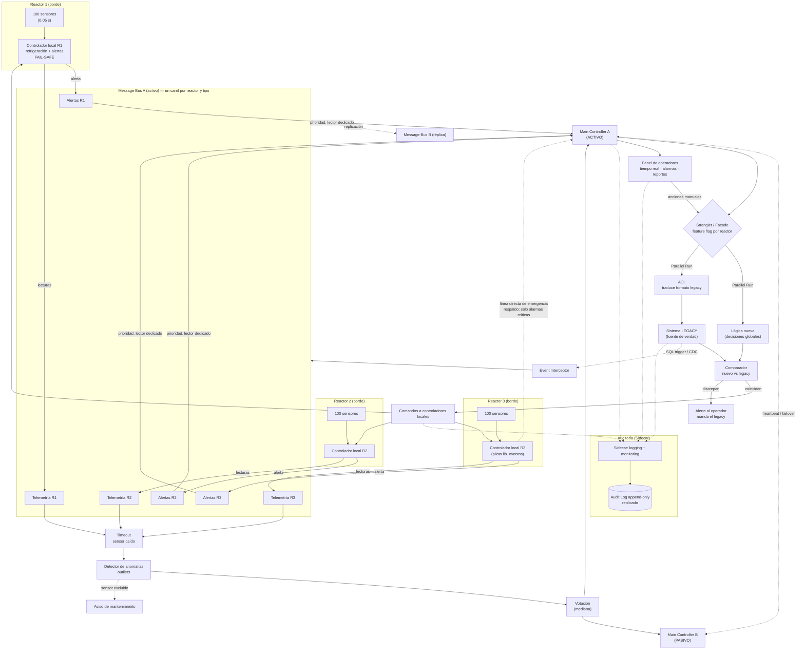
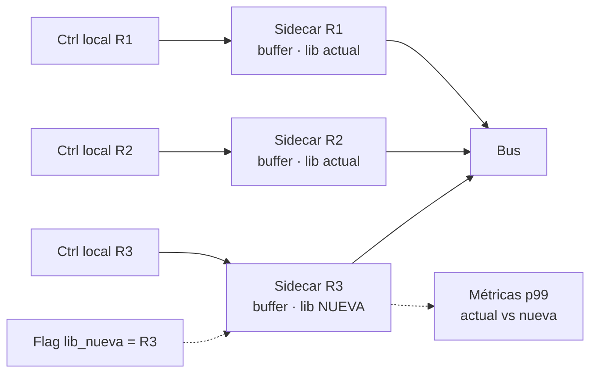

# Lab 12 — Save Chernobyl (medium)

Caso de Estudio #12 · Arquitectura de Software 2026-II · UTEC

## 1. Contexto y problema

Planta nuclear con **3 reactores**. El sistema legacy funciona pero el control es manual: lento, propenso a error humano y sin trazabilidad. Una decisión errónea puede causar un desastre.

**Datos de dimensionamiento**

- 100 sensores por reactor × 3 reactores = **300 sensores**.
- 1 medición cada 0.05 s (20 Hz) → **6.000 mensajes/s** en total, **2.000 msg/s por reactor**.

**Restricción principal:** el legacy no puede reemplazarse ni detenerse; lo nuevo debe coexistir con él. Por eso se descarta Big Bang y se usa **migración evolutiva** (Strangler + por fases + Parallel Run).

## 2. Principios de diseño

1. **Seguridad primero (fail-safe):** ante la duda, el reactor pasa a estado seguro (enfriar), nunca a una acción riesgosa.
2. **Lo crítico decide en el borde:** la protección del reactor vive en el controlador local y no depende de red ni del central.
3. **El legacy es la fuente de verdad** hasta que el nuevo sistema se valide en Parallel Run.
4. **Humano en el lazo:** si nuevo y legacy discrepan, no se ejecuta nada automático y se alerta al operador.

## 3. Diagrama de arquitectura (reliability + fault tolerance)



> Versiones Excalidraw:
> - [`Diagrams/chernobyl-arquitectura-v2.excalidraw`](Diagrams/chernobyl-arquitectura-v2.excalidraw): más nodos y menos texto, con el bus por carriles (generada con `Diagrams/generadores/gen_chernobyl_v2.py`).
> - [`Diagrams/chernobyl-arquitectura.excalidraw`](Diagrams/chernobyl-arquitectura.excalidraw): v1 con explicación dentro del diagrama (generada con `Diagrams/generadores/gen_chernobyl.py`).

## 3.1 ¿Cómo llega primero lo urgente? (bus por carriles)

**Problema (head-of-line blocking):** con una cola única, una alerta del Reactor 3 quedaría detrás de miles de lecturas normales de R1 y R2.

```
❌ [R1][R1][R2][R1][R2]......[R3 ¡recalentándose!] → Main Controller
```

**Solución en 4 capas:**

| Capa | Qué resuelve | Cómo |
|---|---|---|
| 1. Decisión en el borde | La protección no depende del bus | El controlador local enfría solo, en milisegundos |
| 2. Partición por reactor | R3 no hace fila detrás de R1 y R2 | Un carril y un consumidor por reactor, en paralelo |
| 3. Carriles de prioridad | Una alerta no espera entre lecturas normales | El controlador local clasifica: lo que supera el umbral va a **Alertas Rn**, el resto a **Telemetría Rn**; el MC tiene un lector dedicado a alertas |
| 4. Descarte de telemetría vieja | Sobrecarga | Se procesa la última lectura de cada sensor; **las alertas nunca se descartan** |

**Ejemplo (cola de R1 y R2 con 5.000 mensajes):**

| Tiempo | Qué pasa |
|---|---|
| +0 ms | Sensores R3 marcan 395 °C (umbral 380 °C) |
| +5 ms | Ctrl local R3 enfría solo |
| +6 ms | Publica en el carril **Alertas R3**, que está vacío |
| +10 ms | El lector de alertas del MC la recibe sin esperar a R1 ni R2 |
| +15 ms | El MC decide a nivel global y el panel muestra la alarma |

### Línea directa de emergencia (respaldo)

Es un canal **independiente del bus**, solo para alarmas críticas. No reemplaza al bus:

| | Bus | Línea directa |
|---|---|---|
| Transporta | Todo: 6.000 msg/s, alertas, eventos del legacy | Solo alarmas críticas |
| Consumidores | Votación, MC A/B, panel, auditoría | Main Controller |
| Si el receptor cae | Los mensajes esperan en la cola | El mensaje se pierde |
| Función | Camino normal | Respaldo (defensa en profundidad) |

El controlador local envía cada alarma crítica **por ambos caminos**; el MC descarta el duplicado por ID. Si cae el bus, la alarma llega igual por la línea directa. Si caen los dos, el reactor ya está protegido por su controlador local.

## 4. Requisito → tema → solución

| # | Requisito | Tema | Solución |
|---|---|---|---|
| 1 | Sensores cada 0.05 s | Event Interception / CDC + Message Bus | Bus particionado por reactor; el interceptor copia datos del legacy sin modificarlo |
| 2 | Controlador local por reactor | Fault tolerance (borde) | Cada reactor aplica umbrales y refrigeración sin depender del central |
| 3 | Main Controller global | Parallel Run + Strangler + activo/pasivo | Nuevo y legacy deciden en paralelo; B toma el control si A cae |
| 4 | Panel de operadores | Facade + ACL | Una API limpia sobre el legacy; el ACL traduce el formato antiguo |
| 5 | Alertas por umbral | Edge + votación de sensores | Alerta local inmediata, confirmada por varios sensores (evita falsos positivos) |
| 6 | Falla de sensor / central | Fault tolerance | Heartbeats, timeouts, votación, failover, buffer local, modo seguro |
| 7 | Trazabilidad | Sidecar Proxy | Log append-only de quién, qué, cuándo y origen, sin tocar el legacy |
| 8 | Librería nueva de eventos | Branch by Abstraction + feature flag | Interfaz `EventTransport` con implementación vieja y nueva; flag por reactor |
| 9 | Disponibilidad | Redundancia, eliminación de SPOF | Todo componente crítico duplicado |
| 10 | Tiempo real | Decisión en el borde | Lo urgente no pasa por el bus; reportes sí |
| 11 | Legacy no se detiene | Strangler + migración por fases | Reactor 1 → 2 → 3 con legacy de respaldo |

## 5. SPOF identificados y mitigación

| SPOF | Impacto si falla | Mitigación |
|---|---|---|
| Main Controller | Sin decisiones globales en los 3 reactores | Activo/pasivo con heartbeat; si ambos caen, controladores locales en modo seguro |
| Message Bus | Sin datos hacia el central | Réplica B + buffer local en cada controlador local + línea directa de emergencia para alarmas críticas |
| Controlador local | Reactor sin protección autónoma | Par redundante por reactor + protección física/hardware independiente (último recurso) |
| Strangler/Facade | Panel y comandos sin ruta | Dos instancias; los controladores locales no dependen de él |
| BD de auditoría | Pérdida de trazabilidad | Replicación; los eventos se encolan en el sidecar hasta poder escribir |
| Red | Aislamiento de componentes | Enlaces redundantes; el borde opera aislado |
| Un solo sensor | Lectura falsa o ausente | Votación entre sensores; sensor sospechoso se excluye |
| Legacy | Pérdida del sistema actual | Sigue en operación; el nuevo es respaldo, no reemplazo, hasta validar |

## 6. Failure scenarios

| Escenario | Detección | Respuesta |
|---|---|---|
| **Un sensor deja de responder** | Sin dato en > 3 periodos (0.15 s) | Se marca caído, se usa la mediana de los demás, alarma de mantenimiento. Si cae > X % de sensores del reactor → estado seguro |
| **Sensor con valor absurdo** | Desvío fuerte frente a la mediana del reactor | Se excluye (outlier), no dispara apagado; alerta de revisión |
| **Se cae el Main Controller A** | Heartbeat perdido | B asume en segundos; comandos pendientes se reconcilian con el log |
| **Caen A y B** | Ambos sin heartbeat | Controladores locales siguen en modo seguro con reglas locales; alarma máxima |
| **Se cae el bus** | Falla de publicación | Buffer local en el borde; reenvío al volver; alarmas críticas por la línea directa; la protección local no se ve afectada |
| **Alerta de R3 mientras R1 y R2 saturan el bus** | Lag de la cola de telemetría | La alerta va por el carril **Alertas R3** con lector dedicado; no espera a la telemetría |
| **Nuevo y legacy discrepan** | Comparador | No se ejecuta acción automática; manda el legacy; alerta al operador |
| **La librería nueva falla** | Métricas de latencia/errores | Se apaga el feature flag y se vuelve a la implementación anterior |
| **Falla la BD de auditoría** | Error de escritura | Cola en el sidecar; la operación continúa pero con alarma de auditoría degradada |

## 7. Estrategia de migración legacy

**Migración evolutiva híbrida** (no Big Bang):

1. **Fase 0 – Foto actual:** mapear dependencias, flujos de datos y puntos de integración del legacy.
2. **Fase 1 – Observar:** Sidecar + Event Interceptor/CDC. El nuevo sistema solo lee; no controla nada.
3. **Fase 2 – Facade + ACL:** panel y API nuevos sobre el legacy; mismas funciones, mejor interfaz.
4. **Fase 3 – Parallel Run en Reactor 1:** el nuevo decide en paralelo y se compara; el legacy sigue mandando.
5. **Fase 4 – Strangler:** el Reactor 1 pasa a ser controlado por el nuevo con el legacy como respaldo; luego Reactor 2 y Reactor 3.
6. **Fase 5 – Datos:** ETL en batch para el histórico y CDC para sincronizar sin downtime.
7. **Fase 6 – Retiro del legacy** solo cuando los tres reactores estén validados.

**Rollback:** el feature flag por reactor devuelve el control al legacy de inmediato.

## 8. Piloto de la librería de eventos (Sidecar + Branch by Abstraction)

La librería nueva **no se integra dentro del controlador local**: se enchufa en un **sidecar de eventos** que corre junto a cada controlador. El controlador siempre publica a su sidecar (por localhost) y **no cambia**; el sidecar es quien usa una librería u otra para publicar en el bus. El sidecar también hace de **buffer** si el bus cae.



**Por qué un sidecar:**
- El controlador local es crítico: no se toca su código para probar una librería.
- El cambio de librería queda aislado en un proceso aparte; si falla, se reinicia o se cambia el sidecar sin afectar la protección del reactor.
- Dentro del sidecar se aplica **Branch by Abstraction**: una interfaz `EventTransport` con la implementación actual y la nueva, elegida por feature flag.

- Se activa **solo en el Reactor 3** (piloto) con el flag `lib_nueva`.
- Se mide latencia p50/p95/p99 contra la implementación actual con el mismo tráfico.
- **Criterio de éxito:** p99 menor sin pérdida de mensajes durante un periodo acordado.
- **Rollback:** apagar el flag, sin redeploy.
- **Riesgo:** doble implementación a mantener mientras dure el piloto.

## 9. Criterios hipotéticos de escalabilidad

No hay datos reales aún, por lo que son **umbrales supuestos a validar con pruebas de carga**.

**Carga base:** 6.000 msg/s (300 sensores × 20 Hz). Si cada mensaje pesa ~200 B, son ~1,2 MB/s.

| Criterio | Umbral hipotético | Acción |
|---|---|---|
| Lag del carril de **alertas** | > 10 ms | Alarma crítica + más lectores dedicados |
| Alertas descartadas | > 0 | Nunca debería pasar: alarma máxima |
| Lag del carril de **telemetría** de un reactor | > 100 ms sostenido por 1 min | Agregar un consumidor a esa partición |
| Telemetría descartada | > 5 % | Revisar capacidad |
| CPU de consumidores | > 70 % por 5 min | Escalar horizontalmente |
| Latencia p99 de decisión crítica | > 50 ms | Revisar el camino; mover más lógica al borde |
| Uso de disco del log de auditoría | > 70 % | Ampliar/rotar a almacenamiento frío |
| Crecimiento de sensores | > 100 por reactor o más reactores | Una partición y un controlador local por reactor nuevo |

**Estrategia:**
- **Escalado horizontal por reactor:** una partición del bus y un controlador local por reactor, de modo que agregar un reactor no afecta a los demás.
- **Lo crítico no escala por el central:** crece con el borde, así la latencia de seguridad no depende de la carga global.
- **Consistencia eventual solo en lo no crítico** (reportes, histórico); lo crítico mantiene consistencia fuerte.
- **Revisar los umbrales** una vez que haya 2–4 semanas de datos reales.

## 10. Decisiones y trade-offs

| Decisión | Beneficio | Costo |
|---|---|---|
| Strangler + Parallel Run | Riesgo bajo, rollback rápido | Doble mantenimiento y comparación |
| Decisión crítica en el borde | Mínima latencia y autonomía | Reglas duplicadas en cada reactor |
| Activo/pasivo | Failover simple y predecible | Recurso ocioso |
| Legacy como fuente de verdad | Seguridad durante la transición | El nuevo no aporta valor decisorio al inicio |
| Humano ante discrepancias | Evita decisiones erróneas | Más carga de trabajo del operador |
