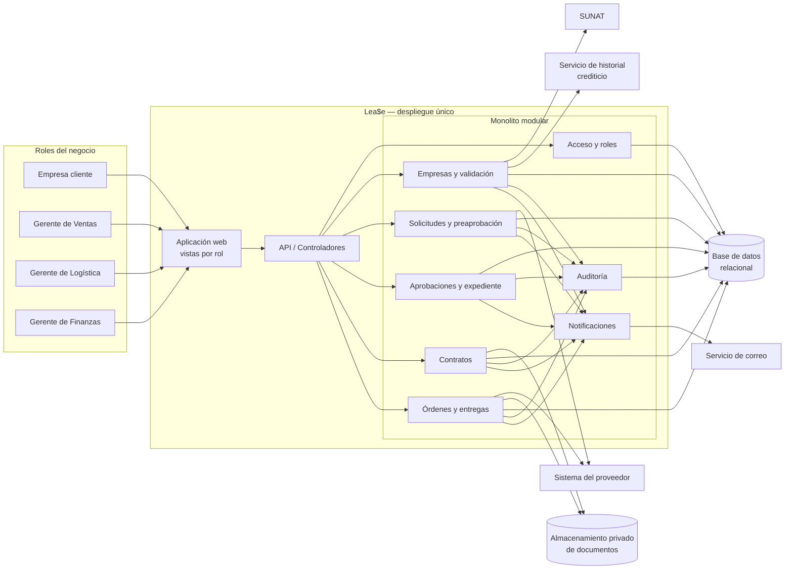
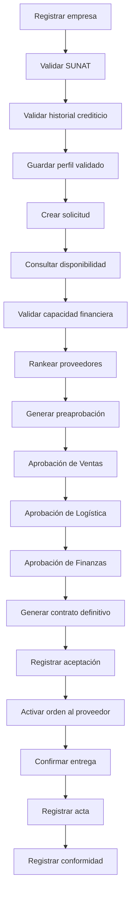

# Parte 1 — Arquitectura básica sin escalar

> **Entregable principal:**
> [diagrama editable en Excalidraw](../Diagrams/parte1-arquitectura-basica.excalidraw).
> Los actores se identifican solo por su rol, según la indicación del docente.
> El lienzo usa cuatro iteraciones top-down: contexto, registro, preaprobación
> y ejecución. En las iteraciones detalladas muestra cada servicio, actor,
> integración y acceso `READ/WRITE/UPDATE` a datos.

## Decisión

Implementar el happy path como un **monolito modular de tres capas**, desplegado
en una sola instancia y respaldado por una base de datos relacional. Los
portales de cliente y gerentes son vistas de una misma aplicación web con acceso
por rol.

Esta es la alternativa más simple para un proceso transaccional único: todos los
módulos trabajan sobre el mismo expediente y varias transiciones requieren
consistencia inmediata. La propuesta conserva límites internos claros sin
introducir la operación distribuida de microservicios.

## Alcance de la arquitectura

La arquitectura soporta exclusivamente el camino exitoso desde el registro de
la empresa hasta la entrega conforme. Incluye las integraciones y documentos
necesarios para ese camino, pero no intenta tolerar fallas, escalar carga ni
procesar incidencias de entrega en esta primera parte.

## Diagrama de contenedores y componentes

## Responsabilidades

| Componente | Responsabilidad en el happy path |
| --- | --- |
| Aplicación web | Presenta formularios y bandejas según el rol; muestra estado, siguiente acción y expediente. |
| API / Controladores | Recibe solicitudes, valida formato y delega cada operación al módulo correspondiente. |
| Acceso y roles | Autentica a los usuarios y autoriza las acciones de cliente, Ventas, Logística y Finanzas. |
| Empresas y validación | Registra la empresa, consulta SUNAT e historial crediticio y conserva el perfil validado. |
| Solicitudes y preaprobación | Crea la solicitud, consulta disponibilidad, valida capacidad, calcula propuesta y ordena proveedores. |
| Aprobaciones y expediente | Aplica el orden de aprobaciones y consolida las decisiones de los tres gerentes. |
| Contratos | Genera las versiones preliminar y definitiva y registra la aceptación del cliente. |
| Órdenes y entregas | Activa la orden, registra la fecha confirmada, el acta y la conformidad. |
| Notificaciones | Envía correo después de cada cambio de estado confirmado. |
| Auditoría | Registra actor, acción, fecha, estado anterior, estado nuevo y motivo. |
| Base de datos relacional | Es la fuente de verdad para empresa, solicitud, aprobaciones, contrato, orden, entrega y auditoría. |
| Almacenamiento de documentos | Guarda contrato preliminar, contrato definitivo y acta; la base conserva sus metadatos y referencias. |

## Flujo interno

Las llamadas a SUNAT, historial crediticio, proveedor y correo se realizan de
forma síncrona en esta versión. Cada operación que cambia un estado actualiza el
expediente y agrega su auditoría dentro de una misma transacción local. Una vez
confirmada esa transacción, el módulo de notificaciones envía el correo.

## Datos principales

| Entidad | Datos mínimos |
| --- | --- |
| Empresa | RUC, razón social, contacto, estado SUNAT, resultado crediticio y fecha de validación. |
| Solicitud | Empresa, productos, cantidades, monto, estado, proveedor candidato y fechas. |
| Evaluación | Capacidad financiera, propuesta preliminar y ranking versionado de proveedores. |
| Aprobación | Tipo, gerente, decisión, comentario y fecha. |
| Contrato | Versión, condiciones de pago, cuotas, entrega, proveedor, documento y aceptación. |
| Orden de compra | Proveedor, productos, fecha de activación, fecha confirmada y estado. |
| Entrega | Acta, receptor, fecha, fin de ventana de 48 horas y conformidad. |
| Evento de auditoría | Caso, actor, acción, estados anterior/nuevo y marca de tiempo. |

## Reglas de consistencia del happy path

1. Una solicitud referencia una empresa previamente validada.
2. Las aprobaciones pertenecen a roles distintos y se aplican en el orden
   Ventas → Logística → Finanzas.
3. El contrato definitivo usa exactamente el proveedor, plazo y plan de cuotas
   aprobados en el expediente.
4. La aceptación del contrato y la activación de la orden son transiciones
   separadas; no existe orden activa sin contrato aceptado.
5. El acta pertenece a una orden entregada y la conformidad debe registrar si
   ocurrió dentro de la ventana de 48 horas.
6. Cada cambio de estado se guarda junto con su evento de auditoría en una
   transacción de la base de datos.

## Decisiones descartadas para esta parte

| Alternativa | Motivo para no usarla aún |
| --- | --- |
| Microservicios | El happy path comparte un expediente y no demuestra necesidad de despliegue o escalamiento independiente. |
| Arquitectura orientada a eventos | La primera versión busca mostrar un flujo secuencial y una respuesta inmediata. |
| Varias bases por dominio | Complican la consistencia de aprobación, contrato y orden sin aportar valor al ejercicio individual. |
| Procesamiento por colas | Es un mecanismo que debe evaluarse en la Parte 3 para desacoplar tareas y tolerar indisponibilidad. |

## Límites deliberados de la versión sin escalar

| Límite | Consecuencia |
| --- | --- |
| Una instancia de aplicación | Su caída detiene todos los canales y roles. |
| Una base de datos | Es un punto único de falla y de capacidad. |
| Integraciones síncronas | La lentitud o caída de SUNAT, riesgo o proveedor bloquea la operación. |
| Correo síncrono | Una falla del correo puede retrasar la respuesta al usuario. |
| Un almacenamiento documental | Su indisponibilidad impide generar o consultar contratos y actas. |
| Sin reintentos ni circuit breaker | Los errores transitorios se devuelven directamente al usuario. |
| Sin cola ni outbox | No se garantiza la entrega diferida de notificaciones u órdenes externas. |
| Sin réplicas ni balanceador | No hay continuidad ante falla ni distribución de carga. |

Estos límites no son propiedades deseadas de producción. Son la línea base
que el equipo deberá transformar en la Parte 3 usando patrones de
confiabilidad, después de consensuar la arquitectura grupal.

## Evidencia esperada para validar la Parte 1

- Demostrar una solicitud que recorra todos los estados hasta `CONFORME`.
- Medir las dos validaciones rápidas y comprobar que cada una responde en menos
  de 3 segundos bajo las condiciones del ejercicio.
- Verificar que los tres gerentes ven el mismo expediente y aprueban con su
  propio rol.
- Comprobar que la orden no se envía antes de la aceptación del contrato.
- Consultar la línea de tiempo completa y los documentos asociados al cerrar el
  caso.
