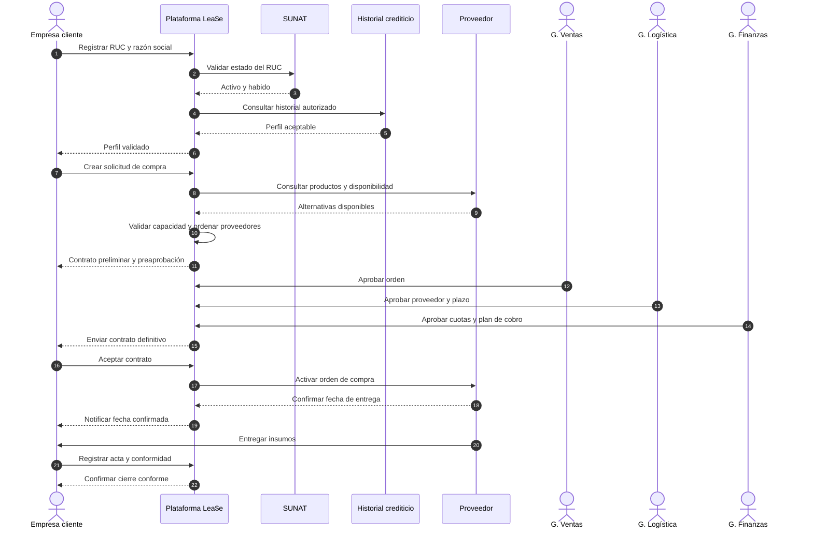
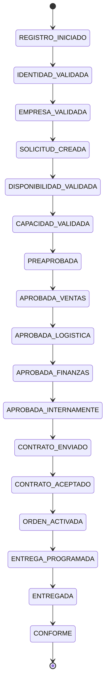

# Parte 1 — Happy path de negocio

## Escenario elegido

**Compra financiada con entrega conforme.** Una empresa cliente que cumple las
validaciones solicita insumos disponibles. Lea$e puede financiar la operación,
los tres gerentes la aprueban, el cliente acepta el contrato, el proveedor
entrega en la fecha acordada y el cliente confirma que los productos están
conformes.

Este recorrido cruza todos los roles necesarios para alcanzar un resultado de
negocio; no termina en la preaprobación ni en un traspaso interno.

## Objetivo y resultado

| Elemento | Definición |
| --- | --- |
| Disparador | La empresa cliente desea que Lea$e compre y financie determinados insumos. |
| Objetivo | Formalizar, comprar y entregar los insumos bajo un plan de pago aceptado. |
| Resultado exitoso | Orden en estado `CONFORME`, con acta de entrega, contrato y plan de cuotas asociados. |
| Actor principal | Representante autorizado de la empresa cliente. |
| Actores internos | Gerente de Ventas, Gerente de Logística y Gerente de Finanzas. |
| Sistemas externos | SUNAT, servicio de historial crediticio, sistema del proveedor y servicio de correo. |

## Precondiciones

- El representante de la empresa puede identificarse y actuar en nombre de ella.
- Los productos solicitados existen en el catálogo de al menos un proveedor.
- Las reglas de validación empresarial, financiamiento y ranking están configuradas.
- Los gerentes cuentan con acceso autenticado a la plataforma interna.
- El proveedor seleccionado puede recibir una orden y confirmar una fecha de entrega.

## Flujo principal

| Paso | Responsable | Acción y resultado observable | Estado resultante |
| ---: | --- | --- | --- |
| 1 | Empresa cliente | Registra RUC, razón social y datos de contacto. | `REGISTRO_INICIADO` |
| 2 | Lea$e | Consulta a SUNAT y confirma que el RUC está activo y habido. | `IDENTIDAD_VALIDADA` |
| 3 | Lea$e | Consulta el historial crediticio; el resultado satisface la política vigente. | `EMPRESA_VALIDADA` |
| 4 | Lea$e | Guarda el perfil validado de la empresa y su evidencia de validación. | `EMPRESA_VALIDADA` |
| 5 | Empresa cliente | Crea una solicitud con productos, cantidades y datos requeridos. | `SOLICITUD_CREADA` |
| 6 | Lea$e | Consulta disponibilidad y obtiene proveedores candidatos para todos los productos. | `DISPONIBILIDAD_VALIDADA` |
| 7 | Lea$e | Comprueba que puede costear la orden y calcula una propuesta financiera inicial. | `CAPACIDAD_VALIDADA` |
| 8 | Lea$e | Ordena los proveedores por idoneidad, genera el contrato preliminar y lo notifica al cliente. | `PREAPROBADA` |
| 9 | Gerente de Ventas | Revisa la solicitud y aprueba comercialmente la orden. | `APROBADA_VENTAS` |
| 10 | Gerente de Logística | Confirma proveedor, condiciones y plazo de entrega. | `APROBADA_LOGISTICA` |
| 11 | Gerente de Finanzas | Calcula y aprueba cuotas y plan de cobro. | `APROBADA_FINANZAS` |
| 12 | Lea$e | Consolida solicitud, aprobaciones, compra, entrega y financiamiento en el expediente. | `APROBADA_INTERNAMENTE` |
| 13 | Lea$e | Genera el contrato definitivo y lo envía a la empresa cliente. | `CONTRATO_ENVIADO` |
| 14 | Empresa cliente | Revisa y acepta el contrato definitivo. | `CONTRATO_ACEPTADO` |
| 15 | Lea$e | Activa la orden de compra para el proveedor seleccionado. | `ORDEN_ACTIVADA` |
| 16 | Proveedor | Confirma fecha y condiciones de entrega; Lea$e las comunica al cliente. | `ENTREGA_PROGRAMADA` |
| 17 | Proveedor / empresa cliente | El proveedor entrega y el cliente firma el acta de entrega. | `ENTREGADA` |
| 18 | Empresa cliente | Dentro de las 48 horas confirma que los insumos están correctos y sin daños. | `CONFORME` |

Cada cambio de estado registra actor, fecha y decisión, y genera la notificación
por correo que corresponde.

## Secuencia del happy path

## Estados del caso

## Cobertura de requisitos

| Sección del enunciado | Cobertura en el happy path |
| --- | --- |
| 1.1 Registro y validación | Pasos 1–4: RUC, SUNAT, historial y perfil validado. |
| 1.2 Solicitud y evaluación inicial | Pasos 5–8: solicitud, disponibilidad, capacidad, ranking y contrato preliminar. |
| 1.3 Evaluación interna | Pasos 9–12: aprobaciones de Ventas, Logística y Finanzas y expediente consolidado. |
| 1.4 Contratación | Pasos 13–14: contrato definitivo y aceptación. |
| 1.5 Activación y coordinación | Pasos 15–16: orden al proveedor, fecha y notificación. |
| 1.6 Entrega y conformidad | Pasos 17–18: acta y verificación dentro de 48 horas. |
| 1.7 Incidencias | No se activa porque el happy path no contiene atraso, daño ni producto incorrecto. |

Los requisitos no funcionales se reflejan en el diseño base mediante una meta
menor a 3 segundos para las validaciones rápidas, historial de estados, correo
ante cambios, acceso autenticado para gerentes y auditoría de aprobaciones. La
Parte 1 no afirma todavía que estas metas se mantengan frente a fallas o alta
carga.

## Criterios de aceptación

- La empresa solo puede crear la solicitud después de quedar validada.
- La preaprobación incluye propuesta financiera y ranking de proveedores.
- El contrato definitivo solo se genera cuando existen las tres aprobaciones.
- La orden al proveedor solo se activa después de la aceptación del cliente.
- La conformidad solo puede registrarse sobre una entrega con acta.
- Al finalizar, el expediente permite reconstruir quién realizó cada acción y cuándo.

## Fuera del happy path

No forman parte de este recorrido: RUC no habido, historial no aceptable,
productos no disponibles, falta de capacidad financiera, rechazo de un gerente
o del cliente, timeout de una integración, atraso, producto incorrecto, daño en
tránsito, fuerza mayor, penalidad, reemplazo, garantía o reasignación. Esos
caminos se incorporarán al comparar propuestas y diseñar la confiabilidad.
